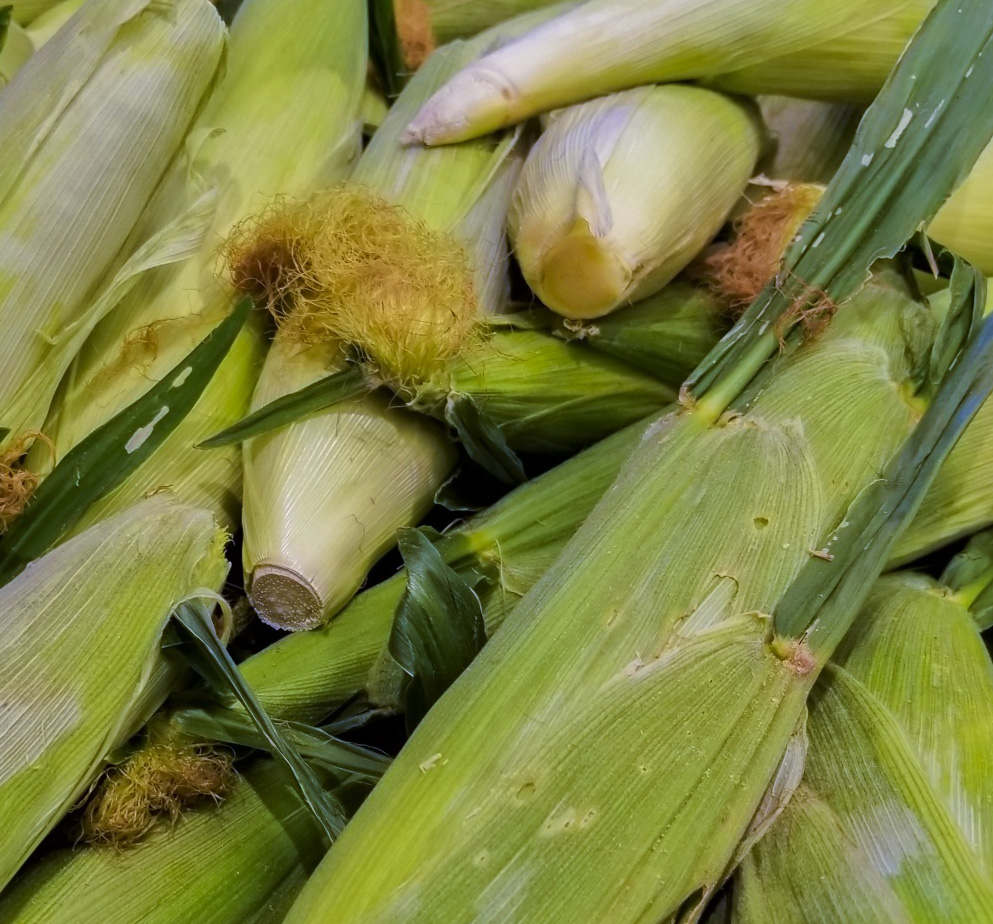

* Preheat oven to 400°F.
* Soak the corn with the husks in place for a few *(15-20 min?)*.
* Drain and place the corn cobs (husks intact) on a baking sheet.
* Bake for 30 minutes, turn once.

*Easy to peel, add a little oil and salt to eat off the cob, or cut off the kernels for other use.*
